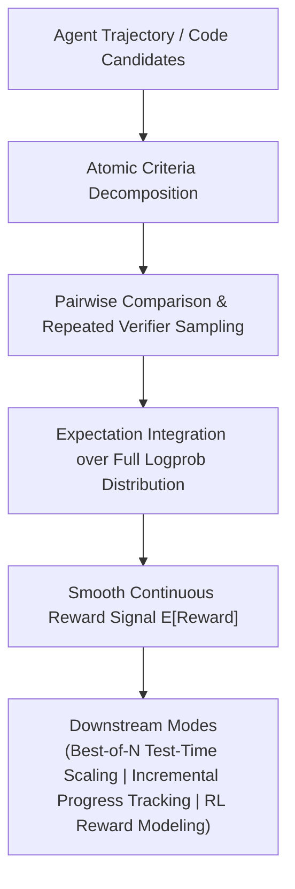

[简体中文](README.md) | English

# LLM-as-a-Verifier

**A unified, general-purpose fine-grained verification and test-time feedback framework for AI agents.**

`LLM-as-a-Verifier` is a versatile verification framework delivering fine-grained feedback across multimodal coding, robotics, and reasoning agents without requiring additional training. By decomposing evaluation criteria, integrating expectations over full token logprob distributions, and scaling repeated comparisons via pairwise reward modeling, it provides continuous, low-variance reward signals for test-time scaling, trajectory progress tracking, and reinforcement learning.

---

## Core Principles & Intuition

Traditional "LLM-as-a-Judge" setups suffer from high variance and discrete scoring collapse. `LLM-as-a-Verifier` introduces three architectural pillars:



1. **Criteria Decomposition**: Breaks complex problem specifications into verifiable atomic sub-criteria.
2. **Expectation Over Logprob Distributions**: Instead of relying on greedily sampled discrete tokens, it calculates expected values over the entire probability distribution of scoring tokens, transforming brittle judgments into smooth continuous metrics.
3. **Test-Time Scaling**: Powers Best-of-N candidate filtering, pairwise verification, and step-level progress tracking across complex problem trajectories.

---

## Quick Start

### Installation

```bash
# Install via PyPI
pip install llm-verifier

# Or install from source
pip install -e .
```

---

## Usage Examples

### 1. Best-of-N Selection (`select`)

```python
import llm_verifier

problem = "Write a function that reverses a string."
candidates = [
    "def rev(s): return s[::-1]",
    "def rev(s): return s",
    "def rev(s): return ''.join(sorted(s))",
]

result = llm_verifier.select(
    problem=problem,
    candidates=candidates,
    criteria={"Correctness": "Does the code actually reverse the string?"},
)

print(result.index)   # Index of the best candidate: 0
print(result.scores)  # Continuous candidate rewards: [0.73104, 0.38446, 0.38449]
```

### 2. Pairwise Candidate Comparison (`compare`)

```python
reward_a, reward_b = llm_verifier.compare(
    problem, 
    candidates[0], 
    candidates[1],
    criteria={"Overall": "Does the code solve the problem efficiently?"},
)
print(reward_a, reward_b)  # Fine-grained normalized rewards in [0, 1]
```

### 3. Step-Level Progress Tracking (`track`)

Quantifies whether an agent's incremental action pushes the overall mission closer to resolution:

```python
progress = llm_verifier.track(
    goal="Fix connection pool leak in issue #42",
    step_history=[
        "Identified unclosed socket context in connection.py",
        "Wrapped connection release logic in try...finally"
    ]
)
print(progress.step_scores)
```

---

## License

This project is open-sourced under the [MIT License](LICENSE).
